# CuraLink

CuraLink is a full-stack health management system with:

- a patient-facing web app
- a doctor-facing web app
- an Express + MongoDB backend
- a separate AI backend for OCR and retrieval-augmented health assistance

The platform is designed to help patients manage health records, discover doctors, book appointments, and analyze medical information with grounded AI support.

## What This Project Already Supports

### Patient portal

- Patient registration and login with JWT auth
- Browse and discover doctors
- View doctor profiles
- Check doctor availability slots
- Book appointments
- View personal appointment history
- Upload and manage health records
- Filter, search, view, and delete uploaded records
- Open an AI analyzer/chat assistant
- Select specific health records as context for AI analysis

### Doctor portal

- Doctor registration and login
- Doctor profile and clinic onboarding
- Upload verification and registration documents
- Create and manage appointment slots
- View all appointments
- View today's appointments
- Live queue management with appointment status updates
- Add patients
- View assigned/linked patients

### Backend platform features

- MongoDB persistence with Mongoose
- Cloudinary-based file storage for uploaded documents and images
- Multipart upload handling with Multer
- JWT-based doctor and patient authentication
- Appointment storage with status tracking
- Structured patient record storage with AI processing state

## AI System Overview

This repo already integrates with a separate AI backend running on `http://127.0.0.1:8001`.

Two key flows are already wired into the application:

### 1. OCR-assisted health record ingestion

When a patient uploads a health record:

1. The file is uploaded from the patient app to the Node/Express backend.
2. The backend stores the file in Cloudinary.
3. A `PatientRecord` document is created in MongoDB.
4. Background OCR is triggered through the external AI backend via `/ocr`.
5. The OCR/structured output is stored back into the record under:
   `aiProcessing.aiStandardizedSummary`
6. The record becomes reusable as medical context inside the AI chat flow.

### 2. AI chat with dual-context RAG behavior

The AI analyzer page supports two usage modes:

- General health assistant mode:
  If the patient does not select any health record, the system sends only the patient question and conversation history.
- Record-grounded mode:
  If the patient selects one or more health records, the system sends:
  - the patient question
  - prior conversation history
  - OCR/AI-standardized summaries of the selected records

That payload is sent to the AI backend through `/askDrBot`, allowing retrieval-augmented reasoning with patient-specific context when available.

## Grounded Medical AI Approach

The intended AI design for CuraLink is not a generic chatbot. It is a health assistant built around retrieval and verification.

Current direction:

- OCR-extracted lab-report metadata is linked to the corresponding health record
- patient record summaries can be injected into the prompt as structured context
- RAG is used so answers are grounded in a curated medical knowledge base
- the knowledge base is planned around chunked medical-book / medical-reference datasets
- answers are meant to include reasoning and evidence-oriented support instead of freeform hallucinated output

## Planned Multimodal Expansion

The next major step is multimodal assistive diagnosis, where the AI system can reason not only over text health records but also over medical images such as:

- X-rays
- CT scans
- MRIs
- ultrasounds
- dermoscopy / dermatology images

The architecture direction is a routed multimodal pipeline with task-specific orchestrators and voting ensembles.

```mermaid
flowchart TB

Query["User Query<br><i>Input can be Text, PDF, or Image</i>"] --> CheckType{"Query Type?"}

CheckType -->|PDF| OCR["OCR Scanner<br><i>Extracts text from PDF medical reports</i>"]
OCR --> PatientState["Patient State Constructor<br><i>Creates structured patient context for RAG prompt injection</i>"]
PatientState --> RAG["RAG Retrieval<br><i>Retrieval-Augmented Generation for text reasoning with vector database</i>"]

CheckType -->|Text| RAG
RAG --> VectorDB["Vector Database (Hybrid Search)<br><i>Embeddings for text and extracted patient info, supports semantic and keyword search</i>"]
VectorDB --> LLM["LLM Inference<br><i>Final diagnosis/recommendation generation</i>"]

CheckType -->|Image| ImageClassifier["Image Classifier<br><i>Soft routing + pre-classification of image modality</i>"]

ImageClassifier --> ChestXray["Chest X-ray Orchestrator"]
ImageClassifier --> ChestCT["Chest CT Orchestrator"]
ImageClassifier --> BrainMRI["Brain MRI Orchestrator"]
ImageClassifier --> BrainCT["Brain CT Orchestrator"]
ImageClassifier --> AbdomenXray["Abdomen X-ray Orchestrator"]
ImageClassifier --> Gallbladder["Gallbladder Stone Orchestrator"]
ImageClassifier --> Kidney["Kidney Stone Orchestrator"]
ImageClassifier --> Dermoscopy["Dermoscopy Orchestrator"]
ImageClassifier --> Dermatology["Dermatology Orchestrator"]

subgraph ChestXrayModels["Chest X-ray Models"]
direction TB
CX1["DenseNet121 / CheXNet"]
CX2["EfficientNet-B4"]
CX3["ResNet50"]
CX4["ViT-B/16"]
CX5["ConvNeXt-T"]
VoteCX["Voting Ensemble"]
end

ChestXray --> CX1 --> VoteCX
ChestXray --> CX2 --> VoteCX
ChestXray --> CX3 --> VoteCX
ChestXray --> CX4 --> VoteCX
ChestXray --> CX5 --> VoteCX

subgraph ChestCTModels["Chest CT Models"]
direction TB
CCT1["3D ResNet-18"]
CCT2["3D DenseNet121"]
CCT3["3D EfficientNet-B0"]
CCT4["3D Swin Transformer"]
CCT5["3D ConvNeXt-T"]
VoteCCT["Voting Ensemble"]
end

ChestCT --> CCT1 --> VoteCCT
ChestCT --> CCT2 --> VoteCCT
ChestCT --> CCT3 --> VoteCCT
ChestCT --> CCT4 --> VoteCCT
ChestCT --> CCT5 --> VoteCCT

subgraph BrainMRImodels["Brain MRI Models"]
direction TB
BMRI1["3D ResNet-50"]
BMRI2["3D DenseNet121"]
BMRI3["3D EfficientNet-B3"]
BMRI4["3D Swin Transformer"]
BMRI5["3D ConvNeXt-T"]
VoteMRI["Voting Ensemble"]
end

BrainMRI --> BMRI1 --> VoteMRI
BrainMRI --> BMRI2 --> VoteMRI
BrainMRI --> BMRI3 --> VoteMRI
BrainMRI --> BMRI4 --> VoteMRI
BrainMRI --> BMRI5 --> VoteMRI

subgraph BrainCTModels["Brain CT Models"]
direction TB
BCT1["3D ResNet-18"]
BCT2["3D DenseNet121"]
BCT3["3D EfficientNet-B0"]
BCT4["3D Swin Transformer"]
BCT5["3D ConvNeXt-T"]
VoteBCT["Voting Ensemble"]
end

BrainCT --> BCT1 --> VoteBCT
BrainCT --> BCT2 --> VoteBCT
BrainCT --> BCT3 --> VoteBCT
BrainCT --> BCT4 --> VoteBCT
BrainCT --> BCT5 --> VoteBCT

subgraph AbdomenXrayModels["Abdomen X-ray Models"]
direction TB
AX1["DenseNet121"]
AX2["EfficientNet-B4"]
AX3["ResNet50"]
AX4["ViT-B/16"]
AX5["ConvNeXt-T"]
VoteAX["Voting Ensemble"]
end

AbdomenXray --> AX1 --> VoteAX
AbdomenXray --> AX2 --> VoteAX
AbdomenXray --> AX3 --> VoteAX
AbdomenXray --> AX4 --> VoteAX
AbdomenXray --> AX5 --> VoteAX

subgraph GallbladderModels["Gallbladder Models"]
direction TB
GB1["DenseNet121"]
GB2["EfficientNet-B3"]
GB3["ResNet50"]
GB4["ViT-B/16"]
GB5["ConvNeXt-T"]
VoteGB["Voting Ensemble"]
end

Gallbladder --> GB1 --> VoteGB
Gallbladder --> GB2 --> VoteGB
Gallbladder --> GB3 --> VoteGB
Gallbladder --> GB4 --> VoteGB
Gallbladder --> GB5 --> VoteGB

subgraph KidneyModels["Kidney Models"]
direction TB
K1["DenseNet121"]
K2["EfficientNet-B4"]
K3["ResNet50"]
K4["ViT-B/16"]
K5["ConvNeXt-T"]
VoteK["Voting Ensemble"]
end

Kidney --> K1 --> VoteK
Kidney --> K2 --> VoteK
Kidney --> K3 --> VoteK
Kidney --> K4 --> VoteK
Kidney --> K5 --> VoteK

subgraph DermoscopyModels["Dermoscopy Models"]
direction TB
D1["ResNet50"]
D2["EfficientNet-B3"]
D3["DenseNet121"]
D4["ViT-B/16"]
D5["ConvNeXt-T"]
VoteD["Voting Ensemble"]
end

Dermoscopy --> D1 --> VoteD
Dermoscopy --> D2 --> VoteD
Dermoscopy --> D3 --> VoteD
Dermoscopy --> D4 --> VoteD
Dermoscopy --> D5 --> VoteD

subgraph DermatologyModels["Dermatology Models"]
direction TB
DM1["ResNet50"]
DM2["EfficientNet-B3"]
DM3["DenseNet121"]
DM4["ViT-B/16"]
DM5["ConvNeXt-T"]
VoteDM["Voting Ensemble"]
end

Dermatology --> DM1 --> VoteDM
Dermatology --> DM2 --> VoteDM
Dermatology --> DM3 --> VoteDM
Dermatology --> DM4 --> VoteDM
Dermatology --> DM5 --> VoteDM

VoteCX --> OutputDefiner["Output Definer<br><i>Combines ensemble outputs and prepares structured evidence for the LLM</i>"]
VoteCCT --> OutputDefiner
VoteMRI --> OutputDefiner
VoteBCT --> OutputDefiner
VoteAX --> OutputDefiner
VoteGB --> OutputDefiner
VoteK --> OutputDefiner
VoteD --> OutputDefiner
VoteDM --> OutputDefiner

OutputDefiner --> LLM
```



## Tech Stack

### Frontend

- React 19
- Vite
- Tailwind CSS
- Framer Motion
- Axios

### Backend

- Node.js
- Express
- MongoDB + Mongoose
- JWT authentication
- Multer
- Cloudinary

### AI layer

- Separate AI backend service
- OCR endpoint for medical reports
- Chat endpoint for health Q&A
- RAG-oriented medical reasoning workflow

## Project Structure

```text
CuraLink/
|-- client/    # Patient-facing React app
|-- doctors/   # Doctor-facing React app
|-- server/    # Express + MongoDB backend
```

## Important Runtime Services

To run the full system, you need all of these:

1. `client` app
2. `doctors` app
3. `server` API
4. separate AI backend service
5. MongoDB
6. Cloudinary credentials

## Environment Variables

Create a `.env` file inside `server/` with values similar to:

```env
MONGO_URI=your_mongodb_connection_string
SECRET_KEY=your_jwt_secret
CLOUD_API_KEY=your_cloudinary_api_key
CLOUD_API_SECRET=your_cloudinary_api_secret
PORT=8000
```

Note:

- The frontends in this repo currently call the Node API at `http://localhost:8000`
- The AI integration currently calls the AI backend at `http://127.0.0.1:8001`
- Setting `PORT=8000` for the Express server is recommended so the current frontend URLs work without changes

## Local Setup

### 1. Install dependencies

```bash
cd server && npm install
cd ../client && npm install
cd ../doctors && npm install
```

### 2. Start the backend API

```bash
cd server
npm run dev
```

### 3. Start the patient app

```bash
cd client
npm run dev
```

### 4. Start the doctor app

```bash
cd doctors
npm run dev
```

### 5. Start the AI backend

Run your separate OCR + RAG service on port `8001` with endpoints such as:

- `POST /ocr`
- `POST /askDrBot`

## Core Data Models

### User

- patient identity and login
- profile basics
- address and appointment references

### Doctor

- doctor identity and credentials
- specialty and clinic information
- consultation fees
- uploaded verification assets

### Appointment

- patient-doctor linkage
- date and time slot
- consultation type
- live status handling
- diagnosis, notes, prescription, and attachments fields

### PatientRecord

- uploaded medical file
- record category
- facility/source and date
- tags
- AI-processed summary storage
- imaging flag

## Key API Areas

### Patient APIs

- `/api/user/register`
- `/api/user/login`
- `/api/user/getDoctorList`
- `/api/user/getDoctorProfile/:doctorId`
- `/api/user/getSlotsOfDoctor`
- `/api/user/bookSlot`
- `/api/user/getAppointmentsAll`
- `/api/user/getUserData`
- `/api/user/uploadHealthRecord`
- `/api/user/getHealthRecordsForUser`
- `/api/user/deleteUserRecord/:id`

### Doctor APIs

- `/api/doctors/register`
- `/api/doctors/login`
- `/api/doctors/createSlots`
- `/api/doctors/GetSlotsOfADate`
- `/api/doctors/deleteSingleSlot`
- `/api/doctors/getAppointmentsAll`
- `/api/doctors/gettodayAppointment`
- `/api/doctors/handleAppointment`
- `/api/doctors/add-patient`
- `/api/doctors/get-patients`

## Current Product Vision

CuraLink is moving toward an end-to-end AI-assisted healthcare workflow:

- manage patient records
- extract structured medical information from reports
- use those reports as context for grounded health Q&A
- support clinician workflows through scheduling and patient management
- expand into multimodal assistive diagnosis for medical imaging

## Safety Note

This project should be treated as an assistive health technology platform, not a replacement for licensed clinical judgment. Any diagnostic or treatment-facing AI output should be reviewed by qualified healthcare professionals before real-world use.
